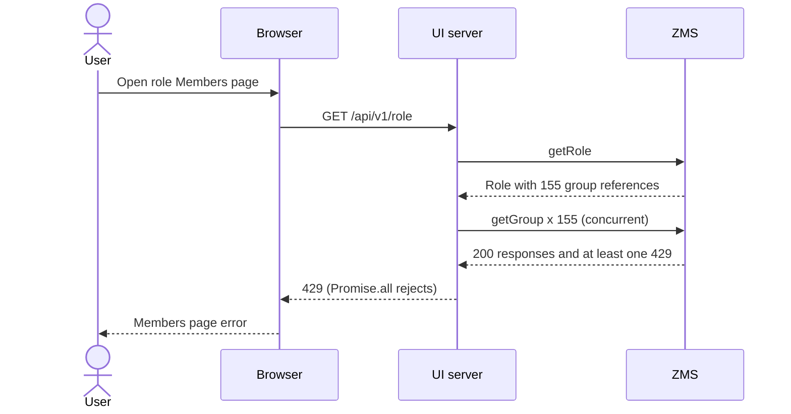
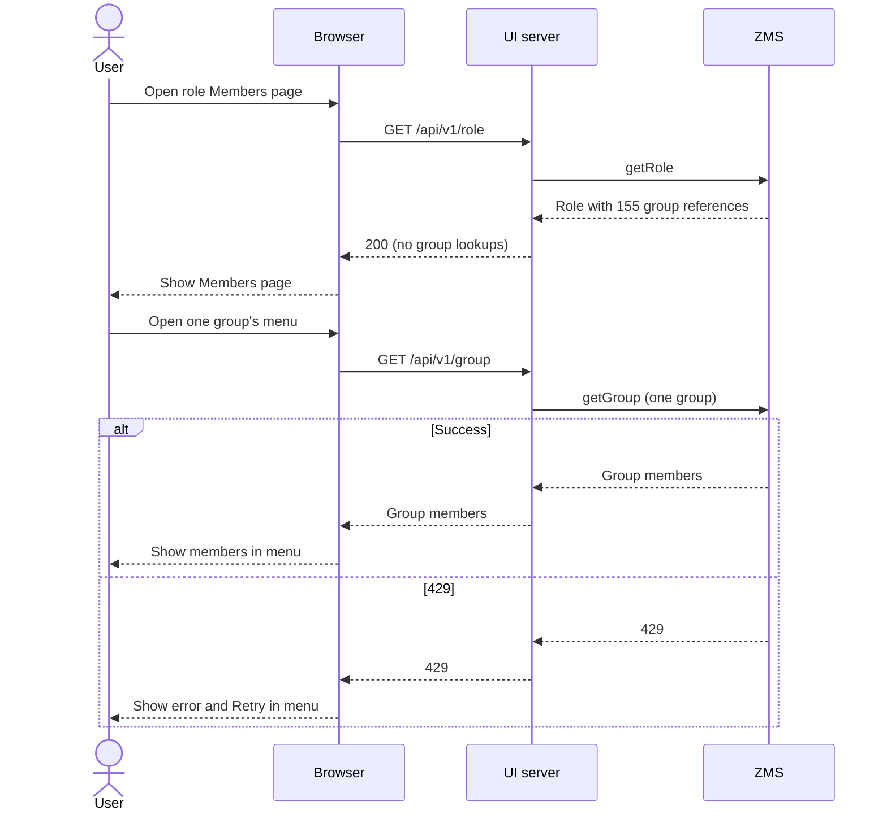

# Role Members page unnecessarily fetches every referenced group and can fail with 429

## What happens

One role has **155 group references** in its `roleMembers` response. Opening that role's **Members page** makes the UI server call ZMS `getRole`, then issue one `getGroup` request for **each group reference at the same time**. The page needs the group names to list the role's members, but it does not need each group's member list until the user opens that group's details menu. No menu has been opened at this point.

If any `getGroup` returns 429, `Promise.all` makes the entire UI `/api/v1/role` request fail with 429. The Members page then cannot render. ZMS access logs show multiple group requests from one visit to the Members page in the same second, with both 200 and 429 responses.

### As-is: group details are fetched before anyone opens a group menu

## Why this can hit the limit

The reported ZMS setting is a **20-token capacity, refilled at 20 tokens per second per server**, with enforcement enabled. There are eight ZMS servers. Perfectly even distribution of 155 requests across eight fresh buckets would just fit (19–20 per server), but neither even distribution nor unused capacity is guaranteed. Other requests from this page and other users can consume the remaining capacity. The exact bucket key and load-balancer behavior still need confirmation.

## Expected behavior (to-be)

Reading a role should return its group references without fetching every group's members. Fetch group members when the user opens that group's details, and show a local error/retry if that request fails. A group lookup failure should not prevent the role page from rendering.

| User action | As-is | To-be |
| --- | --- | --- |
| Open role Members page | Wait for all 155 unnecessary group lookups; one 429 breaks the page | List role members after `getRole`, without group lookups |
| Open a group menu | Members are already loaded if page succeeded | Show loading state, then fetch that group's members |
| Group lookup fails | Members page fails | Menu shows an error and Retry; Members page stays visible |
| Reopen a group menu | No new lookup | Fetch again; details are fresh but the user waits again |

Other page data requests still run in both cases; the table compares the role and group lookup path.

### Trade-off

The menu opens immediately, but its member list appears after one `getGroup` response; a loading state is shown meanwhile. Reopening the menu fetches the group again. This adds latency only to the group details the user chooses to view; the role Members page no longer waits for all group lookups.

## Notes

Athenz supports multiple groups from different domains in one role. The OSS ZMS default role-member quota is **100 per role**, so 155 exceeds the default and is worth reviewing separately; the deployed quota or quota enforcement may differ. Regardless, ZMS returns this role, and listing its members should not turn the references into 155 concurrent requests. The issue is reproducible locally with a mocked 429. A fix is available on `fix/lazy-role-group-members` (`8acb4f2ed`); 77 targeted tests passed.
